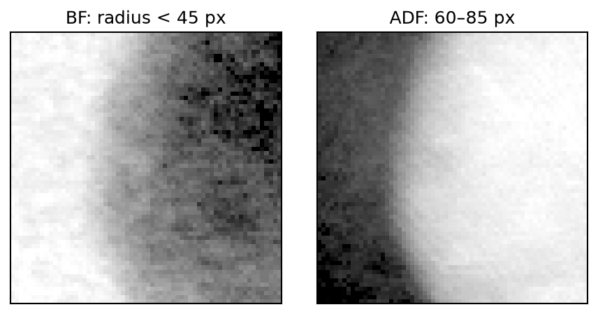

# quantem.gpu

GPU-accelerated 4D-STEM analysis for scientists using Python. Load measurements,
select diffraction patterns, make detector images, and reconstruct phase with
single-sideband ptychography (SSB).

> **Active development.** These examples use the current source checkout.
> APIs may change; follow the [installation guide](install.md) and record
> `git rev-parse HEAD` with results.

## Start with Python

| Start here | What you will do |
|---|---|
| [Install](install.md) | Set up Apple Silicon MPS or NVIDIA CUDA |
| [From acquisition to images](python-workflow.md) | One Gold acquisition: I/O → DPC → SSB |
| {ref}`Advanced Gold tutorial <gold-advanced>` | Inspect aberrations and the model probe; compare 1× and 4× |
| [Save and share your data](api/qem-python.md) | Preserve measurements, calibration, and processing history in QEM |
| [Python API reference](api/index.md) | Check parameters, units, return values, and backend limitations |

## Your first images

```python
from quantem.gpu import io, detector
from quantem.core.visualization import show_2d

data = io.load("gold_master.h5")
show_2d(
    [detector.bf(data), detector.adf(data)], title=["BF", "ADF"],
    norm="power_sqrt", cmap="inferno",
)
```



Each image covers a 512 × 512 scan and uses independent square-root contrast.
This source has no recorded physical sampling, so no physical scale bar is shown.

The detector fits the bright-field disk automatically. Replace `gold_master.h5`
with your file; the acquisition is not bundled. Keep `data` open while working,
then call `data.close()`. The [README](https://github.com/bobleesj/quantem.gpu#load-diffraction-patterns)
contains the same short workflow and additional static image examples.

## SSB in quantem.gpu

quantem fits SSB aberrations with a physical model of the measurement, not an
image-quality score: for each trial set of aberrations, sample tilt and depth
spread it predicts the bright-field data the detector should have recorded and
keeps the parameters whose prediction agrees best (least squares). This
model-based, tilt-corrected fit is the default everywhere, and it is where SSB
in quantem is heading.

| Call | Method | Use it for |
|---|---|---|
| `find_aberrations()` | model-based, tilt-corrected, refined through fifth order | **the default**: every fit |
| `find_aberrations(search="primary", tilt=False)` | model-based, tilt and depth spread held at 0 | thin, untilted samples, or to see what tilt correction changes |

Both refine on exact derivatives of the model agreement. The earlier
phase-variance search (`objective="phase_variance"`), which scored how well the
bright-field pixels' phase images agree instead of predicting the data, is
retired. Backend support and evidence: {ref}`SSB fit methods <ssb-fit-methods>`.

## What stays consistent

Python is the interface; MPS and CUDA are execution backends. Supported options
differ by operation, so limitations are listed beside their API. Ordinary
GPU operations fail explicitly if the requested path is unavailable.

Data use `(scan_rows, scan_cols, detector_rows, detector_cols)` order,
written $I[R_r,R_c,k_r,k_c]$ in the scientific guides. `data[row, col]`
returns a selected GPU Torch tensor. `.sampling`, `.units`, and `.origin`
describe the axes; missing calibration stays unknown. Detector reductions
return small NumPy images while the acquisition remains ANS encoded.

## For developers

The [Developer guide](developer/index.md) groups equations, backend kernels,
native integration, file formats, and verification. [Backend coverage](backends.md)
lists what each runtime implements. The
[verified benchmark results](performance/results.md) retain revision and
hardware provenance. Historical measurements are not promises for every machine.

## Citing quantem.gpu

If quantEM's interactive widgets, GPU-accelerated I/O, or data processing
and reconstruction tools contributed to your research, please consider citing:

> Sangjoon Lee et al., “Interactive Framework for Real-Time 4DSTEM Analysis
> and Reconstruction,” *Microscopy and Microanalysis* 32 (Supplement 1),
> ozag053.941 (2026). https://doi.org/10.1093/mam/ozag053.941

Questions and bug reports belong in the
[issue tracker](https://github.com/bobleesj/quantem.gpu/issues).
