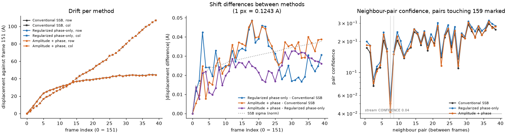

# Does it matter which reconstruction the drift is measured on? (2026-10-24)

## Question

The stream can make each frame as conventional SSB, regularized phase-only or amplitude + phase. Does the choice change the drift `quantem.gpu.drift.drift` measures, and which should drift be registered on?

## Answer

No. On MoS2 bilayer frames 151-191 the three drifts agree to 0.049 Å at most (0.39 px) over 115.7 Å of drift. That is drift's own noise: its σ is 0.02-0.03 Å. Register on SSB, which the stream already makes, and apply the shifts to any reconstruction.

## Setup

- frames 151-191, 512 x 512 scan, 192 x 192 detector, native. Frame 179 was never recorded, so 40 frames. Reference fit on frame 150 (300 kV, 30 mrad, 0.373 Å step, rotation 176.3°, broad search).
- Per-frame optics from `DirectPtycho.stream` (C10, C12, φ12 refitted per frame), which gives the SSB stack. Each frame reopened at those optics for `method="phase"` (regularization 0.03) and `method="complex"` (0.03, 0.03). All stacks 40 x 1536 x 1536 at 0.12435 Å a pixel.
- `drift(stack, sampling_A=(s, s))` with defaults (neighbours 3, so 114 pairs). quantem.gpu snapshot f1cbe8aa, GPU 1.

## Results

| comparison | max \|Δd\| (Å) | rms (Å) |
|---|---|---|
| phase-only vs SSB | 0.049 | 0.029 |
| amplitude + phase vs SSB | 0.048 | 0.032 |
| amplitude + phase vs phase-only | 0.033 | 0.024 |

| | SSB | phase-only | amplitude + phase |
|---|---|---|---|
| pairs rejected (of 114) | 10 | 5 | 8 |
| median pair confidence | 0.128 | 0.154 | 0.137 |
| weakest neighbour pair (158-159) | 0.050 | 0.053 | 0.041 |
| pair rms (Å) | 0.010 | 0.011 | 0.010 |
| triple closure max (Å) | 0.075 | 0.075 | 0.072 |

- The differences grow along the series as σ does: registration noise, not a lattice image (3.2 Å) or a wrong region.
- Every rejected pair is a weak pair outvoted by a confident chain, in all three methods.
- The corrected means differ by reconstruction, not by shift: putting the SSB shifts on the regularized stacks changes their means by 5-6 % of the image std, the fringe motion a 0.03 Å shift gives.
- Phase-only is the most confident (fewest rejections, highest median). Amplitude + phase brings 158-159 to 0.041, just over the stream's live cut of 0.04.

## Speed of drift() itself

Same 40 frames, GPU 0 (600 W card), one warm-up: `drift()` takes 1.03 s for 114 pairs (9 ms a pair), `register` 20 ms for one pair with its own spot search. Registration is PyTorch on the GPU; `running` is CuPy. The CPU holds only bookkeeping: spot clustering (a dozen spots) and the least-squares solve (114 x 39).

85 % of GPU time was one complex128 matrix product per pair: the sub-pixel refinement (`refine`) evaluated the correlation on a 301 x 301 grid (±1.5 px at 1/100 px) as (301 x 1536) @ (1536 x 1536) @ (1536 x 301), 5.3 ms a pair.

Now `refine` searches in two passes: every 1/10 px over ±1.5 px (31 x 31), then every 1/100 px within ±0.1 px of the best (21 x 21). Without the profiler, best of 3 after a warm-up, GPU 0:

| | `drift()`, 40 frames, 114 pairs |
|---|---|
| one 1/100 px grid (frozen baseline) | 0.91 s |
| two passes | 0.36 s (2.5x) |

Against the frozen myptycho baseline the displacements are bit-identical on all 40 frames, the synthetic series and `register(151, 191)`. σ and the triple closure move in the last bit (3e-18 Å) because the offsets are now whole multiples of 1/100 px, not steps of a float arange. Of the 114 pair searches, 113 are unchanged; one pair, (151, 154), moves 0.1 px. That pair matched a wrong region 22 Å off (confidence 0.002) and drift rejects it with or without the change: its correlation is flat, so the coarse pass stops on another local maximum.

## Files

Scripts, `drift.npz` (displacements and σ per method), `summary.json` and the corrected-mean figures (`means_own_shifts.png`, `means_ssb_shifts.png`): a private scratch folder. The float32 stacks were not kept; `reconstruct.py` remakes them.
