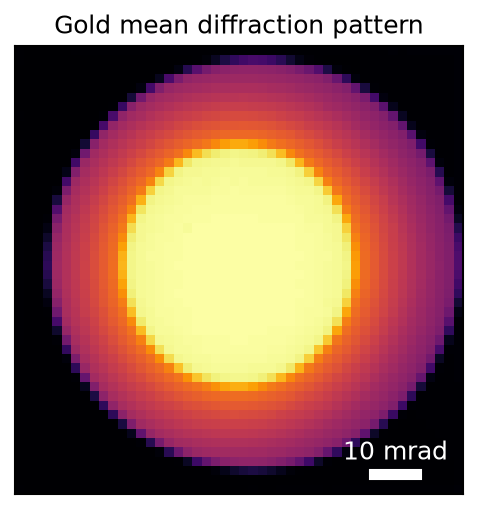
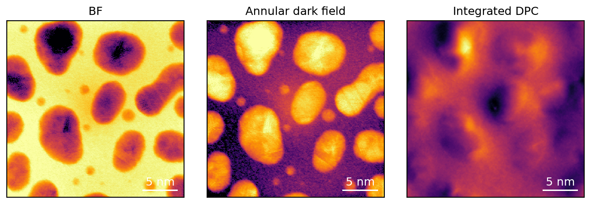
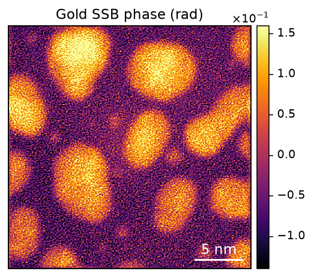

# From acquisition to images

**Load Gold → inspect mean diffraction, BF, ADF and DPC → reconstruct SSB phase.**
Everything needed for a first reconstruction is on this page, using one
acquisition throughout. No QEM conversion is required first.

Follow the [installation guide](install.md) and install `huggingface_hub` for
the download. QuantEM selects the available GPU automatically.
For probe images, fitted coefficients,
search trials, upsampling, and saved results, use the
{ref}`advanced Gold tutorial <gold-advanced>`.

## Development API installation

Use the paired development sources (`quantem.gpu` 0.0.1rc18.dev0 and
`quantem.widget` 0.0.1rc44.dev0). These are source candidates, not a package-index
release; use branch `oct-24-direct-iterative-api` in both repositories and
install both checkouts, or install the matching supplied wheels. An older
widget does not provide the method and regularization controls.

## Get the Gold data

The public [Gold acquisition](https://huggingface.co/datasets/bobleesj/quantem-data/tree/5925e4b49b2ca28ff82d6d5a6b9a8bfea9edfb20/4dstem/gold_512_npy_bin4)
contains a **512 × 512 scan and 48 × 48 detector**. Only the detector was binned
by four before upload. The download is about 1.2 GB, is MIT licensed, and stays
in `data/` for reuse.

```python
from pathlib import Path
import json

from huggingface_hub import snapshot_download
from quantem.gpu import io, detector, dpc, DirectPtycho
from quantem.core.visualization import show_2d

snapshot_download(
    "bobleesj/quantem-data", repo_type="dataset",
    revision="5925e4b49b2ca28ff82d6d5a6b9a8bfea9edfb20",
    allow_patterns="4dstem/gold_512_npy_bin4/*", local_dir="data", token=False,
)
folder = Path("data/4dstem/gold_512_npy_bin4")
metadata = json.loads((folder / "meta.json").read_text())
```

The metadata supplies 300 kV, a 30 mrad convergence semiangle, and
1.84 mrad per detector pixel. Its **0.5 Å scan spacing was inferred from a
sibling acquisition**, not independently calibrated for this file. Scale bars
below retain that qualification.

(mean-diffraction-pattern)=
## Load and view the mean diffraction pattern

```python
data = io.load(folder / "data.npy")
mean_dp = detector.mean(data)
show_2d(
    mean_dp, title="Gold mean diffraction pattern", norm="log_auto",
    cmap="inferno",
    scalebar={"sampling": metadata["sampling"][2], "units": "mrad"},
)
```



This averages all scan positions, leaving the 48 × 48 detector image. Inspect
the bright central disk and surrounding scattering before reconstructing.
Logarithmic display contrast makes weak scattering visible. The scale is
angular: detector pixels describe scattering directions, not sample positions.

## View bright field, dark field, and DPC

For an automatic static BF/DF/ADF and mean-diffraction comparison, use
`detector.show(data)`. Medium panels and two columns are the defaults:

```python
detector.show(data, size="medium", columns=2, cmap="inferno")
```

Choose `size="small"`, `"large"` or `"xlarge"` to resize each panel; set
`columns=1` for a column or `rows=1` for a row. Rows are calculated from columns
unless supplied explicitly. Sizes match the Show2D/Show3D panel proportions
without reducing array resolution.
Set `cmap="gray"` to change colors or `save="detector-images.png"` to save it.
The scan images use square-root contrast; mean diffraction uses logarithmic
contrast. Override these with `norm` and `diffraction_norm`, respectively.
Use the individual detector calls below when you need arrays or custom
collection angles.

```python
bf = detector.bf(data)
adf = detector.adf(data)
dpc_result = dpc.run(data)
show_2d(
    [bf, adf, dpc_result.phase], title=["BF", "Annular dark field", "Integrated DPC"],
    norm=["power_sqrt", "power_sqrt", "minmax"], cmap="inferno",
    scalebar={"sampling": metadata["sampling"][0], "units": "Å"},
)
dpc_result.scan_detector_rotation_mod180_deg, dpc_result.scan_detector_rotation_flipped  # degrees, modulo 180; detector-axis swap flag
```



All three panels show the same 512 × 512 scan. BF integrates the central disk;
ADF is annular dark field, integrating the surrounding ring. The detector
finds the disk automatically. Integrated DPC comes from the measured
center-of-mass shifts. Its displayed contrast is not calibrated in radians.
Each panel uses independent contrast: square-root for BF/ADF and linear for DPC.

DPC estimates the scan–detector rotation, known only modulo 180 degrees. This
Gold acquisition reports `scan_detector_rotation_flipped=False`, so pass the angle and the
flag directly to `DirectPtycho`; `find_aberrations(check_rotation=True)` settles the
180-degree branch. `DirectPtycho` raises if `scan_detector_rotation_flipped` is True. For other data,
check that value first: a detector-axis swap must be resolved before reusing
the angle. `DirectPtycho` does not run DPC automatically.

(reconstruct-phase)=
## Reconstruct SSB phase

Reuse the same acquisition and the DPC rotation above.

```python
ptycho = DirectPtycho(
    data,
    voltage_kV=metadata["voltage_kV"],  # kV
    semiangle_mrad=metadata["probe_semiangle_mrad"],  # mrad
    scan_sampling_A=metadata["sampling"][:2],  # Å per scan pixel, (row, col)
    detector_sampling_mrad=metadata["sampling"][2:],  # mrad per detector pixel, (row, col)
    scan_detector_rotation_deg=dpc_result.scan_detector_rotation_mod180_deg,  # degrees
    scan_detector_rotation_flipped=dpc_result.scan_detector_rotation_flipped,
)
aberrations = ptycho.find_aberrations()
result = ptycho.run(aberrations, upsampling_factor=1)
show_2d(
    result.phase, title="Gold SSB phase (rad)", cmap="inferno", cbar=True,
    scalebar={"sampling": result.object_sampling_A[1], "units": "Å"},
)
```

`DirectPtycho` finds the bright-field disk automatically. `find_aberrations()` is the
default model-based, tilt-corrected fit: on the native grid it fits defocus and
twofold astigmatism together with the sample tilt and a depth spread, keeping
the parameters whose predicted bright-field data agree best with the
measurement. `reconstruct()` uses those parameters without repeating the
search. Voltage, sampling, and convergence angle stay fixed.

| Call | Method | Use it for |
|---|---|---|
| `find_aberrations()` | model-based, tilt-corrected, refined through fifth order | **the default**: every fit |
| `find_aberrations(search="primary", tilt=False)` | model-based, tilt and depth spread held at 0 | thin, untilted samples, or to see what tilt correction changes |

Both refine on exact derivatives of the model agreement
({ref}`Direct Ptycho fit methods <ssb-fit-methods>`).



This is the 512 × 512 native reconstruction: 0.5 Å per output pixel and a
25.6 nm square field using the supplied calibration. Experimental Gold has no
known specimen potential here; the image does not establish quantitative phase
accuracy in the thicker particles. **Use 1× for this example:** the current
4× implementation produces stripes. The
{ref}`advanced comparison <gold-upsampling>` shows the same region at both factors.

Data axes are `(scan_rows, scan_cols, detector_rows, detector_cols)`.
To view one measured pattern, use
`show_2d(data[256, 256], norm="power_sqrt", cmap="inferno")`.
The {ref}`advanced disk-geometry example <gold-disk-geometry>` draws the fitted
center and radius on the mean pattern. [I/O](api/io.md) covers detector crops
and 5D acquisition selection; [Detector and DPC](api/images_dpc.md) covers
manual radii and physical-angle units.

## Finish, or inspect further

Keep the session open for the {ref}`advanced tutorial <gold-advanced>`:

| Inspect or save | Example |
|---|---|
| Fitted coefficients and search candidates | {ref}`Read the aberration search <gold-ssb-reconstruction>` |
| Phase beside the model probe | {ref}`Build the probe image <gold-model-probe>` |
| Native versus 4× phase | {ref}`Compare the same field and particle <gold-upsampling>` |
| Measurements and calibration in one file | [Save as QEM](api/qem-python.md) |

When finished, close the session before its acquisition:

```python
ptycho.close()
data.close()
```


## Review rotation and defocus together

For a calibrated Direct Ptycho session, compare the two 180-degree rotation candidates
with negative and positive C10 search intervals:

```python
comparison = ptycho.compare_rotation_defocus(show=True)
```

Omit `show=True` to return a pandas-style table view without displaying a figure;
`comparison.report()` gives the pandas DataFrame.

This runs four independent 200-trial joint fits with automatic refinement,
retaining all valid BF pixels and the current field of view. It preserves the
session's scientific parameters. The figure pairs Auto-sampled phases with
native-pixel histograms, sharing contrast and the displayed region. Use
`comparison.show(view_fraction=1)` for the full field without refitting.

The result remains **unresolved** without an independent constraint. Similar
losses or phase polarity alone do not establish the physical rotation. Both
sign intervals include zero, so a zero-boundary fit does not determine a sign.
Compare an independently known focus only at the same reference plane and
with the convention `f = -C10`. Depth spread is a fitted model parameter.

## Browse reconstructed focus images

`ptycho.show("focus")` uses the existing Show2D gallery. Pass `layout="stack"`
to scroll through defocus in Show3D, or `interactive=False` for static core
views. See the [Direct Ptycho view options](api/direct_ptycho.md) for focus spacing, depth values,
region selection and panel sizes.

Detector calibration plots use the same display vocabulary:

```python
detector_fit = data.calibration.fit_detector_sampling()
detector_fit.show(size="medium", cmap="inferno", save="detector-fit.png")
```

The fit view has one panel. Detector and SSB galleries additionally accept
`rows` or `columns`. For example,
`ptycho.show("focus", mode="static", columns=2, cmap="inferno", save="focus.png")`
exports the focus comparison without changing its reconstructed pixels.
